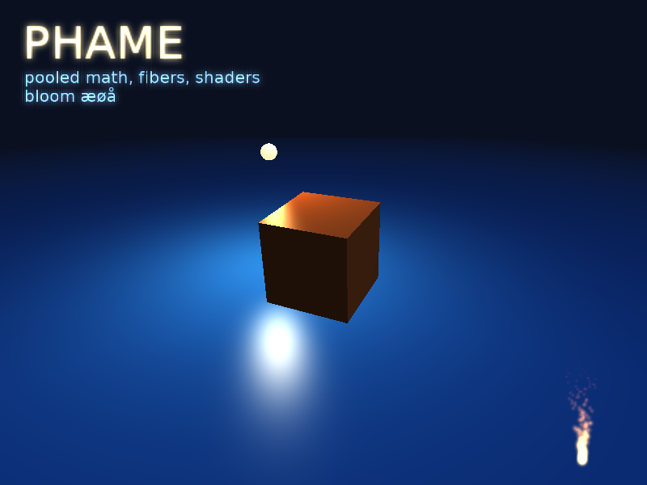
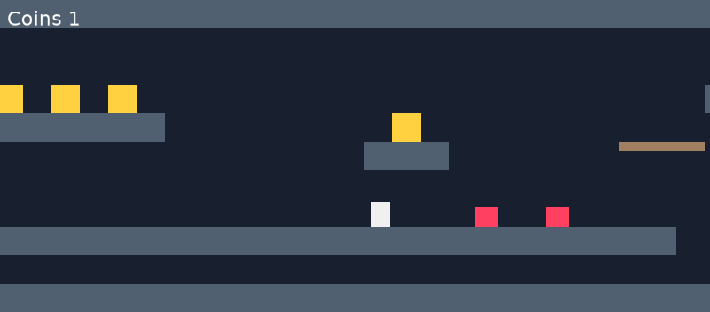
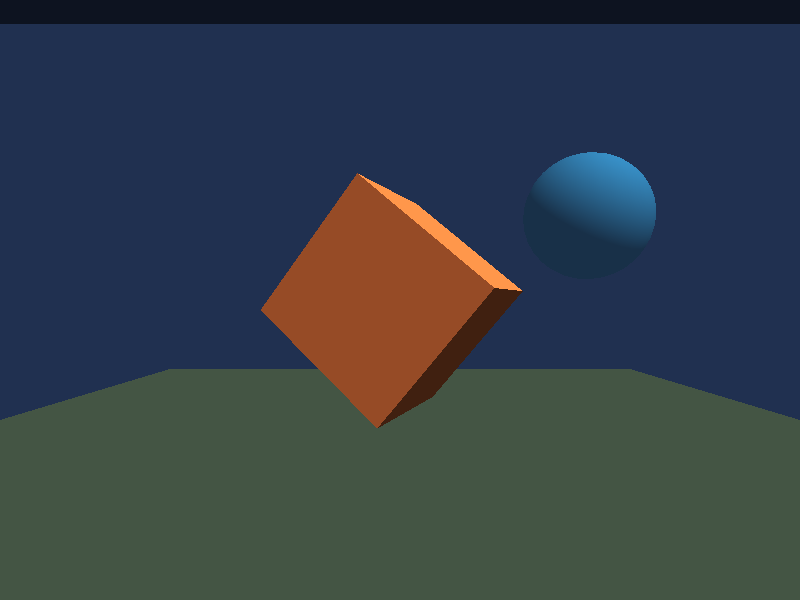
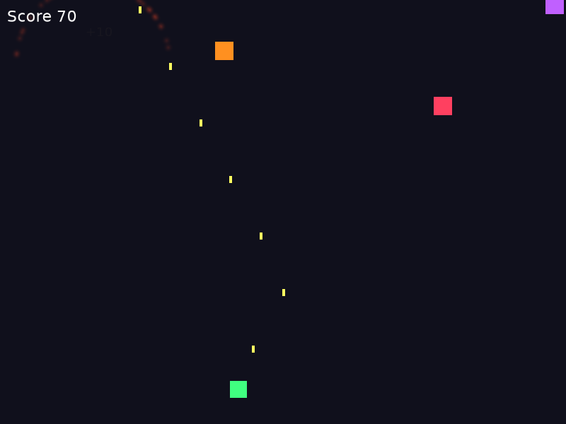

# Phame: a mini manual

Phame is a 2D and 3D game engine for PHP 8.5. It draws with OpenGL through PHP's FFI and SDL2, and its game logic
is written as **coroutines**: straight-line code that waits for the next frame, for a tween, for a key press or for
an animation to finish, instead of state machines spread across `update()` methods.

The display list is modelled on Starling (the Flash/AIR engine): sprites, images, text and particles in a tree,
with a 3D scene as just another display object. Everything runs in one PHP process, with no PHP extension other
than FFI and no native library other than SDL2.



## Contents

- [Why coroutines](#why-coroutines)
- [Features](#features)
- [Getting started](#getting-started)
- [The display list](#the-display-list)
- [Game logic: coroutines and ownership](#game-logic-coroutines-and-ownership)
- [Input](#input)
- [Animation: tweens, sprite sheets, particles](#animation-tweens-sprite-sheets-particles)
- [Levels: TileMap](#levels-tilemap)
- [Text and audio](#text-and-audio)
- [3D](#3d)
- [Shaders, filters and render textures](#shaders-filters-and-render-textures)
- [Performance](#performance)
- [Testing games headless](#testing-games-headless)
- [Requirements and limitations](#requirements-and-limitations)

## Why coroutines

In most engines an enemy that should walk to the player, wait half a second, shoot three times and repeat becomes
an `update()` method with a state variable, timers and a switch. In Phame it is the code you would describe it with:

```php
$enemy->go(function () use ($enemy, $player) {
    while (true) {
        Async::tween($enemy, 1.5, ['x' => $player->x], Transitions::EASE_IN_OUT);   // walk
        Async::wait(0.5);                                                             // aim
        for ($i = 0; $i < 3; ++$i) {                                                  // burst
            shoot($enemy, $player);
            Async::wait(0.2);
        }
    }
});
```

The coroutine belongs to `$enemy`. When the enemy is removed from the stage, the loop ends where it waits, and its
`finally` blocks run. There are no entity lists to keep in sync and no cleanup code.

## Features

**Engine**
- A frame loop on phasync fibers; game logic as coroutines owned by objects
- A global clock (`$engine->clock`: `time`, `delta`, `timeScale`, `paused`, `frame`), game time and real time
- A built-in frame profiler (`updateTime`, `renderTime`, `frameTime`)
- Engine-driven motion (`velocityX`/`velocityY`) and conditions (`Async::until()`), so coroutines sleep until something happens
- Exceptions in game code stop the game and surface from `run()`, never vanish in a fiber
- Headless mode for automated tests, bots and screenshots

**2D**
- Starling-style display list: `Sprite`, `Quad`, `Image`, `MovieClip`, `BitmapText`, `ParticleSystem`, `TileMap`
- Batched rendering: thousands of quads in one draw call; blend modes (normal, add, multiply, screen)
- Bubbling events, touch and mouse with hit testing, keyboard
- Tweens with easing, delayed calls, a juggler

**Gameplay helpers**
- `TileMap`: levels from text, tile collision without tunnelling, pickups
- `overlaps()` and `firstOverlap()` for collisions, without allocations
- Sprite-sheet animation from Sparrow/TexturePacker atlases or uniform grids
- Simulated input for bots and tests

**3D**
- `Scene3D` embeds a lit, depth-tested scene in the 2D display list
- Meshes, boxes, planes, spheres, cameras, picking with the mouse
- A sun, ambient light, up to four point lights, specular highlights, emissive materials, fog
- Custom GLSL surface shaders (`shade()`) and vertex displacement (`displace()`)

**Effects**
- Render textures (draw anything, including 3D, into a texture)
- Filters on any object: blur, glow, drop shadow, bloom, color matrix, or your own GLSL

**Text and audio**
- Bitmap fonts (BMFont), with a tool to make them from TrueType; a default font is included
- Sound effects and music from WAV, mixed by SDL; generated beeps for prototypes

**Performance by design**
- Pooled math objects (`Vector3`, `Matrix4`, `IntRect`) with private constructors: no per-frame allocation
- No arrays built per frame in the renderer or the math

## Getting started

```bash
composer require phasync/phasync   # Phame's only PHP dependency
sudo apt install libsdl2-2.0-0     # the only native library
php examples/shooter.php           # a complete game
```

A complete program: a square that follows the mouse and pulses.

```php
<?php
require 'vendor/autoload.php';

use Phame\{Async, Engine};
use Phame\Animation\Transitions;
use Phame\Display\Quad;

$engine = new Engine(800, 600, 'Hello Phame');
$box = $engine->stage->addChild(new Quad(40, 40, 0xFF8040));
$box->pivotX = $box->pivotY = 20;

$engine->run(function (Engine $engine) use ($box) {
    $box->go(function () use ($box) {                       // pulse forever
        while (true) {
            Async::tween($box, 0.4, ['scaleX' => 1.5, 'scaleY' => 1.5], Transitions::EASE_OUT);
            Async::tween($box, 0.4, ['scaleX' => 1.0, 'scaleY' => 1.0], Transitions::EASE_IN);
        }
    });
    $box->go(function () use ($box, $engine) {               // follow the mouse, smoothly
        while (true) {
            $dt = Async::awaitFrame();
            $box->x += ($engine->mouseX - $box->x) * min(1, 10 * $dt);
            $box->y += ($engine->mouseY - $box->y) * min(1, 10 * $dt);
        }
    });
});
```

`run()` returns when the window closes or `$engine->quit()` is called.

## The display list

Everything visible is a `DisplayObject` in a tree under `$engine->stage`. Coordinates are in points, with y
pointing down; rotations are in radians.

```php
$ship = new Sprite();                       // a container
$ship->addChild(new Image(Texture::fromPng('ship.png')));
$ship->addChild($flame = new Quad(6, 12, 0xFF8000));
$flame->y = 30;
$ship->x = 400;
$ship->rotation = M_PI / 4;
$ship->alpha = 0.8;
$engine->stage->addChild($ship);
```

| Class | What it is |
|---|---|
| `Sprite` | A container: transforms, alpha and filters apply to all its children |
| `Quad` | A colored rectangle, or a textured one |
| `Image` | A quad sized after its texture |
| `MovieClip` | An image that plays frames from a sprite sheet |
| `BitmapText` | Text from a bitmap font, with alignment and wrapping |
| `ParticleSystem` | Thousands of particles in one draw call |
| `TileMap` | A level made of tiles, with collision |
| `Scene3D` | A 3D scene embedded in the 2D tree |

Objects have `x`, `y`, `scaleX`, `scaleY`, `rotation`, `pivotX`, `pivotY`, `alpha`, `visible`, `blendMode`,
`filter`, `width` and `height` (which scale the object), and `removeFromParent()`.

## Game logic: coroutines and ownership

`$object->go($fn)` starts a coroutine that belongs to `$object`. It ends when the object leaves the stage, is
disposed, or when `cancelCoroutines()` is called; then its `finally` blocks run. `$engine->go($fn)` starts one
that lives as long as the game, or as long as the object whose coroutine started it.

| Wait | Returns when |
|---|---|
| `Async::awaitFrame()` | the next frame (returns its delta in seconds) |
| `Async::wait($seconds)` | game time has passed (respects pause and `timeScale`) |
| `Async::tween($obj, $seconds, ['x' => 100], $easing)` | the tween has arrived |
| `Async::awaitEvent($dispatcher, $type)` | the event is dispatched |
| `Async::awaitKey(Key::SPACE)` | the key is pressed |
| `Async::awaitTouch($object)` | the object is clicked or tapped |
| `Async::race($a, $b, ...)` | the first of several coroutines finishes; the others are cancelled |
| `Async::timeout($seconds, $fn, $default)` | `$fn` finished, or time ran out |
| `Async::until($condition)` | the condition, checked by the engine every frame, returns a value |

Ownership follows the object, not the code that started it. A bullet fired by the player belongs to the bullet:

```php
$player->go(function () use ($player, $bullets) {
    while (true) {
        Async::wait(0.12);
        $bullet = $bullets->addChild(new Quad(4, 10, 0xFFFF60));
        $bullet->x = $player->x;
        $bullet->y = $player->y;
        $bullet->go(function () use ($bullet) {          // keeps flying if the player dies
            $bullet->velocityY = -600;                   // the engine moves it; this coroutine sleeps
            Async::until(fn () => $bullet->y < -10);     // ...until it has left the screen
            $bullet->removeFromParent();
        });
    }
});
```

Removing an object cancels its coroutines with an exception at the wait they are in, which unwinds them and runs
their `finally` blocks. Loops that prefer to stop on their own can check `Async::cancelled()`, which costs nothing.

### Wake up only when there is something to do

A coroutine that wakes every frame to move something and check whether it has arrived costs a few microseconds per
frame. Most of the time it can sleep instead, and let the engine do the frame-by-frame work in its own tight loops:

- `Async::tween()` moves an object to a target and wakes the coroutine once, on arrival.
- `velocityX` and `velocityY` (points per second) make the engine move an object every frame.
- `Async::until($condition)` lets the engine check a condition once per frame without waking the coroutine; it
  returns the condition's value when that is not null or false.
- `$a->firstOverlap($group)` finds what `$a` collides with, without allocating anything.

```php
$bullet->velocityY = -600;
$enemy = Async::until(fn () => $bullet->y < -10 ? true : $bullet->firstOverlap($enemies));
if ($enemy instanceof Quad && $enemy->parent !== null) {   // another bullet may have hit it in the same frame
    $enemy->removeFromParent();
}
$bullet->removeFromParent();
```

The engine checks all conditions together, after moving objects and before waking coroutines, and computes each
object's collision box only once per frame for all of them. Two rules follow: a condition should only test, never
change anything, and two coroutines can see the same hit in the same frame, so check that the target is still there.
In a test with 6,000 bullets against 20 enemies, this style takes 21 ms of game logic per frame instead of 86 ms
(Ryzen 9 9950X3D).

A whole game round is a function, and restarting is clearing the world:

```php
while (true) {
    $player = startRound($world);                         // sets up objects and their coroutines
    Async::awaitEvent($player, Event::REMOVED_FROM_STAGE); // the player died
    showGameOver();
    Async::awaitKey(Key::SPACE);
    $world->removeChildren(dispose: true);                // every coroutine of the round ends here
}
```

## Input

```php
if ($engine->isKeyDown(Key::LEFT)) { ... }               // held keys, for movement
$key = Async::awaitKey();                                 // the next key press
$button->addEventListener(Event::TOUCH, fn (TouchEvent $e) => ...);
Async::awaitTouch($button);                               // wait for a click
$hit = $scene3d->pick($x, $y);                            // the 3D mesh under the mouse
```

`Key` has constants for letters, digits, arrows, function keys and modifiers. `$engine->simulateKey()` and
`$engine->pointer()` inject input exactly as the player would, for bots, replays and tests.

## Animation: tweens, sprite sheets, particles

```php
Async::tween($coin, 0.3, ['y' => $coin->y - 40, 'alpha' => 0.0], Transitions::EASE_OUT);
$engine->juggler->tween($door, 1.0, ['x' => 200], Transitions::EASE_OUT_BOUNCE);   // without waiting
```

Sprite sheets, one animation per row:

```php
$atlas = TextureAtlas::grid(Texture::fromPng('hero.png'), 32, 32, ['idle', 'run', 'jump']);
$hero = new MovieClip($atlas->frames('idle_'), 8);
$hero->frames = $atlas->frames('run_');                   // switch animation
$hero->loop = false;
Async::awaitEvent($hero, Event::COMPLETE);                // wait for the last frame
```

TexturePacker and similar tools export the Sparrow format: `TextureAtlas::fromSparrow('sheet.xml')`.

Particles:

```php
$fire = new ParticleSystem(512);
$fire->emissionRate = 200;
$fire->lifetime = 1.0;
$fire->speed = 60;
$fire->spread = 0.6;
$fire->gravityY = -40;
$fire->startColor = 0xFFC040;
$fire->endColor = 0xC01000;
$fire->endAlpha = 0.0;
$fire->start();                    // or $fire->burst(30) for an explosion
```

## Levels: TileMap



```php
$level = new TileMap(<<<MAP
    ####################
    #      o o o       #
    #     #######   o  #
    #  P           ### #
    ####################
    MAP, 32);
$level->style('#', 0x506070)->style('o', 0xFFD040);

$player->go(function () use ($engine, $player, $level) {
    $vy = 0.0;
    while (true) {
        $dt = Async::awaitFrame();
        $level->move($player, ($engine->isKeyDown(Key::RIGHT) - $engine->isKeyDown(Key::LEFT)) * 200 * $dt, 0);
        $vy += 1400 * $dt;
        if ($level->move($player, 0, $vy * $dt) & (TileMap::DOWN | TileMap::UP)) {
            $vy = 0.0;                                           // landed, or hit the ceiling
        }
        if ($level->isOnGround($player) && $engine->isKeyDown(Key::SPACE)) {
            $vy = -560.0;
        }
        if ($level->take($player, 'o')) {
            Sound::tone(1200, 0.08)->play();                     // a coin
        }
    }
});
```

`move()` returns the sides the body was stopped on and never lets fast bodies pass through walls. Only the visible
tiles are drawn, in one batch.

## Text and audio

```php
$score = new BitmapText('Score 0', null, 24, 0xFFFFFF);   // default font, 24 points
$score->text = "Score $points";
$score->hAlign = BitmapText::CENTER;
$score->wrapWidth = 300;
```

`php bin/make-font font.ttf 32 name` turns a TrueType font into a bitmap font (the default is DejaVu Sans, with
æøå and the rest of Latin-1).

```php
$hit = Sound::load('hit.wav');
$hit->play(0.8);                                          // volume
$music = Sound::load('theme.wav')->play(0.5, loop: true);
$music->stop();
Async::awaitEvent(Sound::load('fanfare.wav')->play(), Event::COMPLETE);
$beep = Sound::tone(900, 0.06, 'square', 300);            // a generated sound effect, no file needed
```

## 3D



A `Scene3D` is a display object: 2D objects can be drawn above and below it, and filters apply to it.

```php
$scene = $engine->stage->addChild(new Scene3D(800, 600));
$scene->background = 0x203050;
$scene->camera->setPosition(0, 3, 7);
$scene->camera->lookAt(0, 0, 0);

$cube = new Mesh(Geometry::box(1.5, 1.5, 1.5), new Material(0xFF8040, specular: 0.8));
$scene->root->addChild($cube);

$lamp = new PointLight(0xFFD080, 2.0, 10.0);
$scene->root->addChild($lamp);

$cube->go(function () use ($cube) {
    while (true) {
        $cube->rotationY += Async::awaitFrame();
    }
});
```

Right-handed, y up; the camera looks down -z. `Node3D::forward()`, `right()` and `up()` give a node's axes for
camera-relative movement. `Scene3D::pick($x, $y)` returns the mesh under a point, and `Mesh::intersects()` tests
two meshes against each other.

## Shaders, filters and render textures

A custom surface shader is a GLSL function. This one makes water: vertices move in waves and the surface is shaded
from the slope, with the scene's lights and specular highlights:

```php
$water = new Mesh(Geometry::plane(40, 40, 64), new Material(shader: new MeshShader(<<<'GLSL'
    vec3 displace(vec3 p, vec3 n, vec2 uv) {
        p.y += sin(p.x * 1.1 + uTime * 1.6) * 0.3 + sin(p.z * 1.4 - uTime * 1.2) * 0.25;
        return p;
    }
    vec4 shade() {
        vec3 n = normalize(flatNormal());
        vec3 base = mix(vec3(0.02, 0.08, 0.3), vec3(0.1, 0.35, 0.7), n.y);
        return vec4(base * sceneLight(n) + sceneSpecular(n), 1.0);
    }
    GLSL)));
```

Filters work on any display object, its children included:

```php
$title->filter = new BloomFilter(1.2, 10, 0.55);          // bright parts glow
$hud->filter = new GlowFilter(0x00FFFF, 1.5, 8);          // a cyan halo
$menu->filter = ColorMatrixFilter::grayscale();            // while paused
$player->filter = new GlowFilter(0x000000, 0.6, 4, 4, 4);  // a drop shadow
$screen->filter = new Filter(<<<'GLSL'                     // your own: a CRT wobble
    vec4 filterPixel(vec2 uv) {
        uv.x += sin(uv.y * 80.0 + uTime * 5.0) * 0.002;
        return texture(uTexture, uv);
    }
    GLSL);
```

Render textures draw anything into a texture, a 3D scene included:

```php
$minimap = new RenderTexture(200, 150);
$minimap->draw($world);
$engine->stage->addChild(new Image($minimap->texture));
```

## Performance

`php examples/benchmark.php` measures what fits in a 60 fps frame on your machine, split into game logic, building
the draw calls (render) and waiting for the GPU. Times are milliseconds per frame; 16.7 ms is the budget for 60
frames per second. Lower is better.

| Scenario | Ryzen 9 9950X3D (2025) | + JIT | Xeon E5-2697 v3 (2014) | + JIT |
|---|---:|---:|---:|---:|
| 1,000 sprites, each moved by its own coroutine | 2.7 | 2.2 | 5.6 | 4.3 |
| 5,000 sprites, each moved by its own coroutine | 14.7 | 11.9 | 37.6 | 25.7 |
| 10,000 sprites, each moved by its own coroutine | 33.7 | 29.4 | 84.4 | 62.6 |
| Bullet churn: 100 new bullets per frame, 1 s life (6,000 live) | 19.5 | 16.9 | 62.6 | 49.3 |
| Particles: 10,000 live | 10.4 | 9.0 | 12.5 | 7.0 |
| 3D: 500 lit, spinning meshes and 4 point lights | 5.3 | 4.7 | 9.0 | 7.7 |
| `Matrix4` product / inverse (µs per call) | 0.29 / 0.60 | 0.08 / 0.56 | 0.70 / 1.46 | 0.26 / 1.38 |

Measured headless at 800×600 with PHP 8.5. The Xeon renders on an RTX 3090; the Ryzen machine rendered in software
(Mesa llvmpipe) at the time, so its GPU share is CPU time, which makes its numbers conservative.

Split of one row, 5,000 coroutine sprites on the Ryzen without the JIT: 9.2 ms game logic, 4.9 ms building and
submitting the draw calls, 0.7 ms rasterizing.

How to read it:

- **Waking coroutines every frame is the expensive pattern.** Each wake costs about 1.4 µs on the Ryzen and 4 µs on
  the Xeon (a plain method call costs 0.02 to 0.06 µs). Let tweens, velocities and `Async::until()` do the
  per-frame work, and wake coroutines only when something happens: see
  [Wake up only when there is something to do](#wake-up-only-when-there-is-something-to-do). The sprite rows above
  deliberately wake every coroutine every frame.
- **The JIT helps.** `opcache.enable_cli=1 opcache.jit=tracing` speeds up math-heavy code.
- **The GPU is never the bottleneck** for 2D: Phame's cost is PHP on the CPU. A 2025 desktop CPU is about 2.5 times
  as fast as a 2014 server CPU for game logic.

## Testing games headless

`new Engine(800, 600, headless: true)` renders without a window, so games can be tested in CI and by bots:

```php
$engine = new Engine(800, 600, headless: true);
$engine->clock->forcedDelta = 1 / 60;                     // deterministic time
$engine->maxFrames = 600;                                 // 10 seconds of game time
$engine->run(function (Engine $engine) {
    startGame($engine);
    $engine->go(function () use ($engine) {               // a bot that holds right and jumps
        $engine->simulateKey(Key::RIGHT, true);
        while (true) {
            Async::wait(0.9);
            $engine->simulateKey(Key::SPACE, true);
            Async::wait(0.3);
            $engine->simulateKey(Key::SPACE, false);
        }
    });
});
$engine->saveScreenshot('after-10-seconds.png');
```

Headless audio is mixed silently on game time, so sounds still end and dispatch their events. Phame's own test
suite (`vendor/bin/phpunit`) works this way: it renders scenes and checks pixels read back from the GPU.

## Requirements and limitations

- PHP 8.5 with FFI, SDL2, and OpenGL 3.3 (any GPU from the last decade, or Mesa in software)
- Linux is tested; macOS and Windows are supported by the code but not yet tested
- Audio is WAV only (convert OGG/MP3); no gamepad support yet
- 3D: no shadows, no model loader (glTF/OBJ), no skeletal animation, no instancing yet

## Examples

| File | What it shows |
|---|---|
| `examples/shooter.php` | A complete arena shooter in 200 lines: waves, three enemy behaviours, particles, shake, sound |
| `examples/platformer.php` | TileMap, gravity, coyote time, moving platform, enemies, camera follow |
| `examples/showcase.php` | 3D with point light, wave shader, fog, bloom-filtered text, particles |
| `examples/cube.php` | A minimal 3D scene with coroutines |
| `examples/benchmark.php` | The performance numbers above, on your machine |


